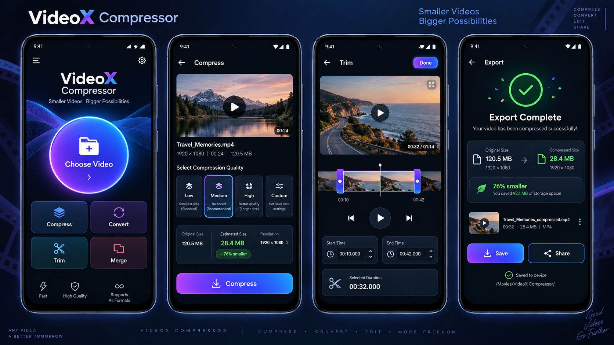

<div dir="rtl">

# VideoX Compressor Pro

[](../../actions/workflows/android.yml)


تطبيق أندرويد لضغط الفيديو وقصّه وتحويله ودمجه، وكل المعالجة تتم **داخل الجهاز** بدون إنترنت وبدون رفع أي ملف.


<sub>صورة تصميم مفاهيمي للواجهة.</sub>

## الميزات

| الأداة | التفاصيل |
|---|---|
| **ضغط وتحويل** | ثمان ملفات ضغط جاهزة (صغير/متوسط/كبير وHD) مع الحجم المتوقع، أو حجم محدد بالميغابايت، أو وضع مخصص بسلايدرات للدقة والـ Bitrate. يقرأ الصيغ القديمة مثل RMVB وFLV وWMV، وH.265 تلقائي، وتحسين ذكي يخفض الدقة بدل التكسّر. التحويل إلى MP4 وMKV وMOV وWebM وAVI و3GP، أو تغيير الصيغة بدون إعادة ضغط، أو استخراج الصوت MP3/M4A |
| **محرر الفيديو** | خط زمني مثل تطبيقات المونتاج: تقسيم عند المؤشر، وحذف جزء، وتكرار، وقص بالمقابض، وإضافة فيديوهات ودمجها، وتغيير الترتيب بالسحب، وسرعة لكل مقطع، وكتم، وتراجع وإعادة، وتصدير بأبعاد 9:16 أو 16:9 أو 1:1 مع خلفية مضببة |
| **محرر الصوت** | نفس أدوات المحرر للصوت، مع موجة صوتية حقيقية، ودمج ملفات MP3 أو أصوات الفيديوهات، وتصدير MP3 أو M4A أو WAV |
| **معالجة دفعة** | ضغط عدة فيديوهات بالتتابع في الخلفية |
| **أدوات Pro** | تدوير وعكس، وسرعة من 0.5× إلى 2×، وتحسين الصورة، وتنظيف الصوت، وحذف الـ Metadata والموقع |
| **قوالب جاهزة** | واتساب وتيليغرام وجودة عالية، وحفظ إعداداتك كقالب |

ومن التفاصيل الأخرى:
- المعالجة تستمر في الخلفية مع إشعار يعرض التقدم وزر إلغاء.
- شاشة مقارنة بين الأصل والنتيجة ونسبة التوفير الحقيقية.
- الحفظ في `Movies/VideoX Compressor` والمشاركة المباشرة.
- لا يطلب صلاحية الإنترنت ولا صلاحية قراءة كل الملفات.

## المتطلبات

- Android 8.0 (API 26) فأحدث.
- البناء: JDK 17، وAndroid SDK 35.

> **ملاحظة عن المعالجات:** محرك FFmpeg المضمَّن يدعم `arm64-v8a` و`x86_64` فقط. على الهواتف القديمة بمعالج 32-bit تعمل أدوات MediaCodec (الضغط والقص والتحويل إلى MP4/3GP/WebM وMP3 وWAV)، أما الأدوات التي تعتمد على FFmpeg (المحرر، وMKV/MOV/AVI، وأدوات Pro، وM4A/OGG) فتعرض رسالة بأنها غير مدعومة بدل أن يتوقف التطبيق.

## البناء

### Android Studio أو Gradle

```bash
./gradlew assembleDebug          # نسخة تجريبية
./gradlew assembleRelease        # نسخة الإصدار (تحتاج إعداد التوقيع أدناه)
```

### بدون Gradle (بدون إنترنت)

```bash
export ANDROID_SDK_ROOT=/path/to/android-sdk
export JAVA_HOME=/path/to/jdk-17
./build.sh
```

### توقيع نسخة الإصدار

مفتاح التوقيع **لا يُرفع إلى GitHub أبداً**. انسخ الملف `keystore.properties.example` إلى `keystore.properties` واكتب فيه مسار المفتاح وكلمات المرور. الملف `keystore.properties` ومجلد `signing/` مستثنيان من Git.

ولبناء نسخة موقّعة تلقائياً على GitHub Actions، أضف هذه القيم في
**Settings → Secrets and variables → Actions**:

| Secret | القيمة |
|---|---|
| `VIDEOX_KEYSTORE_BASE64` | ناتج الأمر `base64 -w0 VideoX-release.keystore` |
| `VIDEOX_KEYSTORE_PASSWORD` | كلمة مرور المفتاح |
| `VIDEOX_KEY_ALIAS` | `videox` |
| `VIDEOX_KEY_PASSWORD` | كلمة مرور الـ alias |

كل تحديث يُرفع إلى فرع `main` ينشر تلقائياً ملف APK تجريبي في صفحة **Releases**، ويضيف معه نسخة موقّعة إذا كانت الأسرار مضافة.

> ⚠️ لتحديث التطبيق فوق النسخ المثبتة سابقاً يجب استخدام **نفس المفتاح** الذي وُقّعت به.

## هيكل المشروع

```
app/src/main/java/com/mohannadsatlink/videox/
├── MainActivity.java       الشاشة الرئيسية وشاشات الضغط والنتائج
├── EditorActivity.java     محرر الفيديو والصوت (الخط الزمني والمعاينة والتصدير)
├── TimelineView.java       الخط الزمني: تمرير، تكبير، تحديد، قص بالمقابض، ترتيب بالسحب
├── TimelineClip.java       بيانات المقطع على الخط الزمني
├── MediaPreviewCache.java  لقطات الفيديو والموجة الصوتية للخط الزمني
├── ProcessingService.java  خدمة المعالجة بالخلفية وإشعار التقدم
├── VideoTranscoder.java    ضغط/تحويل بالعتاد (MediaCodec + OpenGL)
├── CodecSurface.java       سطح OpenGL لتحجيم وقص الإطارات
├── FfmpegTranscoder.java   صيغ إضافية وأدوات Pro والدمج بانتقال (FFmpegKit)
├── VideoMerger.java        دمج سريع بدون إعادة ترميز
├── Mp3Transcoder.java      تحويل الصوت إلى MP3 (LAME)
├── WavTranscoder.java      تحويل الصوت إلى WAV
├── VideoTrimBar.java       شريط القص بلقطات الفيديو
├── CompressProfiles.java   قائمة ملفات الضغط الجاهزة والوضع المخصص
├── VideoInfo.java          قراءة معلومات الفيديو (مع FFprobe للصيغ القديمة)
└── VideoFileProvider.java  مشاركة الملفات الناتجة (قراءة فقط)
```

## المكتبات المستخدمة

راجع [THIRD_PARTY_NOTICES.md](THIRD_PARTY_NOTICES.md). أهمها FFmpegKit (LGPL-3.0) وTAndroidLame / LAME (LGPL).

## سجل التغييرات

راجع [CHANGELOG.md](CHANGELOG.md).

## المطوّر

**مهند سات لنك**

</div>

---

### English summary

**VideoX Compressor Pro** is an offline Android app (8.0+) for compressing, trimming, converting and merging videos and extracting audio. All processing happens on-device using MediaCodec/OpenGL and a bundled FFmpegKit build. Build with `./gradlew assembleDebug`, or `./build.sh` for an offline build. Release signing is configured through a git-ignored `keystore.properties` file or CI secrets (see above).
